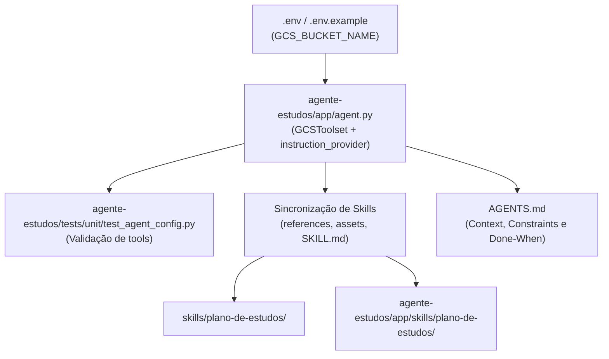

# Plano de Implementação: Substituição do EnvironmentToolset pelo GCS Toolset

Este documento apresenta o planejamento técnico e operacional completo para a substituição do **`EnvironmentToolset`** (gravação em sistema de arquivos local) pelo **`GCSToolset`** ([adk.dev/integrations/gcs](https://adk.dev/integrations/gcs/)) no projeto **`agente-estudos`**.

O plano foi elaborado de forma autossuficiente para que qualquer agente possa executar a migração futuramente de forma autônoma.

---

## 1. Visão Geral e Justificativa

| Aspecto | Antes (`EnvironmentToolset`) | Depois (`GCSToolset`) |
|---|---|---|
| **Destino do Arquivo** | Disco local (`agente-estudos/planos/`) | Google Cloud Storage Bucket (`gs://<bucket>/...`) |
| **Persistência** | Volátil em ambientes serverless/containers | Durável, escalável e centralizada |
| **Ferramentas Expostas** | `WriteFile`, `ReadFile` | `create_object`, `get_object_data` |
| **Filtragem de Ferramentas** | Subclasse `FerramentasDeArquivo` com override de `get_tools()` | Parâmetro nativo `tool_filter` do ADK |
| **Formato de Retorno** | Leitura com prefixo de número de linhas (`1\tSubject...`) | Leitura de string pura no campo `results` |
| **Autenticação** | Local filesystem (sem auth de nuvem) | Application Default Credentials (ADC) via `google.auth` |

---

## 2. Mapa de Arquivos a Serem Alterados



### Relação dos Arquivos:
1. `agente-estudos/.env.example` e `agente-estudos/.env`
2. `agente-estudos/app/agent.py`
3. `AGENTS.md`
4. `skills/plano-de-estudos/SKILL.md` e `agente-estudos/app/skills/plano-de-estudos/SKILL.md`
5. `skills/plano-de-estudos/references/workflow.md` e `agente-estudos/app/skills/plano-de-estudos/references/workflow.md`
6. `skills/plano-de-estudos/references/salvar_agenda.md` e `agente-estudos/app/skills/plano-de-estudos/references/salvar_agenda.md`
7. `skills/plano-de-estudos/assets/plano_template.md` e `agente-estudos/app/skills/plano-de-estudos/assets/plano_template.md`
8. `skills/plano-de-estudos/assets/exemplo_plano.md` e `agente-estudos/app/skills/plano-de-estudos/assets/exemplo_plano.md`
9. `agente-estudos/tests/unit/test_agent_config.py`

---

## 3. Especificação Técnica das Mudanças

### 3.1. Dependências
O `pyproject.toml` já possui `google-adk[gcp]>=2.12.0` e `google-cloud-storage` instalado no ambiente virtual (`.venv`). Nenhuma alteração é necessária no `pyproject.toml`.

### 3.2. Configuração em `agente-estudos/app/agent.py`

#### Substituições de Código:
1. **Remover:**
   * `from google.adk.environment import LocalEnvironment`
   * `from google.adk.tools.environment import EnvironmentToolset`
   * Classe `FerramentasDeArquivo`
   * Diretório `PLANOS_DIR`
2. **Adicionar:**
   * `import google.auth`
   * `from google.adk.integrations.gcs import GCSToolset`
   * `from google.adk.integrations.gcs.gcs_credentials import GCSCredentialsConfig`
   * `from google.adk.integrations.gcs.settings import GCSToolSettings, Capabilities`
3. **Instanciação do `GCSToolset`:**
   ```python
   GCS_BUCKET_NAME = os.getenv("GCS_BUCKET_NAME", "agente-estudos-planos")

   try:
       credentials, _ = google.auth.default()
       credentials_config = GCSCredentialsConfig(credentials=credentials)
   except Exception:
       credentials_config = None

   gcs_toolset = GCSToolset(
       tool_filter=["create_object", "get_object_data"],
       credentials_config=credentials_config,
       gcs_tool_settings=GCSToolSettings(capabilities=[Capabilities.READ_WRITE]),
   )
   ```
4. **Instrução (`instruction_provider`):**
   ```python
   def instruction_provider(context=None) -> str:
       hoje = datetime.date.today().strftime("%d/%m/%Y")
       return (
           f"Hoje é {hoje}.\n"
           "Você é um mentor especialista em estudos. Seu objetivo é ajudar a pessoa a organizar "
           "seus estudos de forma personalizada, criando planos executáveis com base na skill plano-de-estudos.\n"
           "Siga a regra de gating da skill: se faltar objetivo, prazo, disponibilidade ou nível atual, "
           "pergunte apenas o que falta e não carregue recursos antecipadamente.\n"
           f"Quando tiver todas as informações, siga o workflow da skill e salve o CSV no bucket '{GCS_BUCKET_NAME}' "
           "com o nome 'plano-de-estudos.csv' usando a ferramenta create_object."
       )
   ```
5. **Configuração do `root_agent`:**
   ```python
   root_agent = Agent(
       name="agente_estudos",
       model=Gemini(
           model=MODEL_NAME,
           retry_options=types.HttpRetryOptions(attempts=3),
       ),
       instruction=instruction_provider,
       tools=[skill_toolset, gcs_toolset],
   )
   ```

---

### 3.3. Contrato de Comunicação das Ferramentas GCS

* **Gravação (`create_object`):**
  * Argumentos: `bucket_name` (str), `object_name` (str, ex: `"plano-de-estudos.csv"`), `data` (str, conteúdo CSV puro).
  * Resposta de sucesso: `{"status": "SUCCESS", "results": "Object plano-de-estudos.csv created successfully in bucket <bucket_name>."}`.
* **Leitura no Replanejamento (`get_object_data`):**
  * Argumentos: `bucket_name` (str), `object_name` (str).
  * Resposta de sucesso: `{"status": "SUCCESS", "results": "<conteudo_csv_em_texto>", "encoding": "text"}`.

---

### 3.4. Atualização das Skills

Manter sincronia estrita entre `skills/plano-de-estudos/` e `agente-estudos/app/skills/plano-de-estudos/`:
1. `references/salvar_agenda.md`:
   * Atualizar documentação das ferramentas para `create_object` e `get_object_data`.
   * Indicar parâmetros `bucket_name`, `object_name` e `data`.
   * Atualizar exemplos JSON de requisição e resposta.
2. `references/workflow.md`:
   * No Passo 4: salvar com `create_object` no bucket informado.
   * No replanejamento: ler com `get_object_data` e sobrescrever com `create_object`.
3. `SKILL.md`:
   * Atualizar Passo 4 do checklist mencionando `create_object`.
4. `assets/plano_template.md` e `assets/exemplo_plano.md`:
   * Seção 5: exibir mensagem de confirmação com `gs://[bucket]/plano-de-estudos.csv`.

---

### 3.5. Atualização de Regras e Testes

1. **`AGENTS.md`**:
   * Substituir referências ao `EnvironmentToolset` por `GCSToolset`.
   * Atualizar constraints de ferramentas e variáveis de ambiente obrigatórias (`GCS_BUCKET_NAME`).
2. **`agente-estudos/tests/unit/test_agent_config.py`**:
   * Atualizar teste para validar `GCSToolset` e a presença exata das ferramentas `["create_object", "get_object_data"]`:
   ```python
   @pytest.mark.asyncio
   async def test_gcs_toolset():
       gcs_toolset = next(t for t in root_agent.tools if isinstance(t, GCSToolset))
       tools = await gcs_toolset.get_tools()
       tool_names = [t.name for t in tools]
       assert sorted(tool_names) == ["create_object", "get_object_data"]
   ```

---

## 4. Checklist de Execução Autônoma

1. **Fase 1: Ambiente e Regras**
   - [ ] Atualizar `agente-estudos/.env.example` e `agente-estudos/.env` com `GCS_BUCKET_NAME`.
   - [ ] Atualizar `AGENTS.md`.
2. **Fase 2: Código do Agente**
   - [ ] Atualizar `agente-estudos/app/agent.py`.
3. **Fase 3: Documentação e Sincronização de Skills**
   - [ ] Atualizar arquivos em `skills/plano-de-estudos/`.
   - [ ] Sincronizar para `agente-estudos/app/skills/plano-de-estudos/`.
4. **Fase 4: Testes Automatizados**
   - [ ] Atualizar `agente-estudos/tests/unit/test_agent_config.py`.
   - [ ] Rodar `cd agente-estudos && uv run pytest tests/unit`.
5. **Fase 5: Validação Final**
   - [ ] Validar com `git status` que não há vazamentos de segredos ou arquivos temporários.
