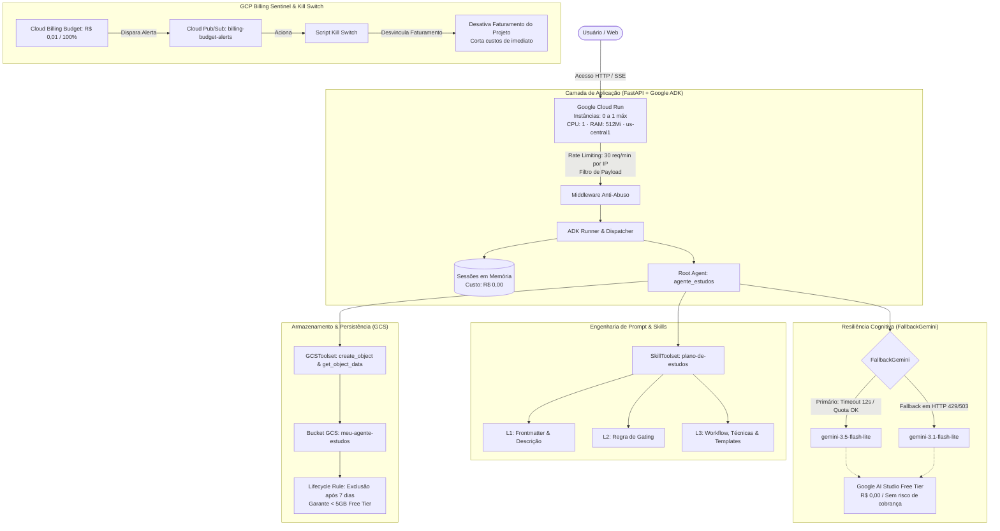

# 🧠 Agente de Estudos - Arquitetura de IA com Google ADK no Cloud Run

[](https://cloud.google.com/run)
[](https://adk.dev/)
[](https://www.python.org/)
[-00C853)](https://cloud.google.com/free)
[](LICENSE)

O **Agente de Estudos** é um agente inteligente de engenharia cognitiva construído com o **Google Agent Development Kit (ADK)** e orquestrado no **Google Cloud Run**. Ele atua como um mentor especialista que transforma metas de aprendizado em cronogramas executáveis com revisão espaçada, autoavaliações semanais e exportação direta para o Google Agenda via arquivos CSV estruturados.

Projetado sob a premissa de **disponibilidade pública e custo zero perpétuo (R$ 0,00)**, o projeto implementa uma arquitetura de defesa em múltiplas camadas contra custos inesperados e abusos na nuvem.

---

## 🌐 Teste o Agente em Produção

O agente está implantado e disponível publicamente no Cloud Run com interface interativa (ADK Web UI):

👉 **[Acessar Interface do Agente de Estudos (Cloud Run)](https://agente-estudos-939983769220.us-central1.run.app/)**

---

## 🏛️ Arquitetura do Sistema



---

## 🧩 Desafios Técnicos e Soluções Aplicadas

Abaixo está o detalhamento dos desafios de engenharia enfrentados no desenvolvimento e na implantação do agente, acompanhados das respectivas soluções arquiteturais:

### 1. Engenharia do Agente e Inteligência Cognitiva

* **Problema:** LLMs comuns tendem a gerar planos de estudo genéricos quando recebem poucas informações, além de sofrerem de perda de foco e alto consumo de tokens quando todo o material de referência (instruções pedagógicas, templates, regras de formatação) é colado diretamente na instrução primária do agente.
* **Solução:**
  * **Divulgação Progressiva em 3 Níveis (ADK Skills):**
    * **L1 (Metadata):** Apenas nome e descrição da skill são visíveis no catálogo inicial.
    * **L2 (Gating Rule):** O corpo do `SKILL.md` condiciona o avanço à presença estrita de 4 variáveis fundamentais: **objetivo**, **prazo**, **disponibilidade** e **nível atual**. Faltando qualquer item, o agente pergunta apenas o que falta e **não carrega** recursos adicionais.
    * **L3 (Recursos sob Demanda):** Somente após o gating ser satisfeito, o agente usa `load_skill_resource` para ler o `workflow.md`, `tecnicas.md` (revisão espaçada, checkpoints) e `plano_template.md`.

---

### 2. Persistência em Nuvem e Replanejamento sem Sobrecarga

* **Problema:** Sistemas conteinerizados são efêmeros por natureza (perda de arquivos locais após o desligamento da instância). Além disso, quando um usuário relata sessões de estudo perdidas, agentes ingênuos frequentemente empilham todo o conteúdo acumulado em um único dia, sobrecarregando o estudante.
* **Solução:**
  * **Integração com `GCSToolset`:** O agente foi desacoplado do sistema de arquivos local e configurado com o `GCSToolset` do ADK, expondo exclusivamente `create_object` e `get_object_data`.
  * **Ciclo de Replanejamento:** O agente lê o plano vigente do bucket com `get_object_data`, redistribui a matéria atrasada de forma gradual ao longo dos dias disponíveis e grava o novo arquivo `plano-de-estudos.csv` atualizado via `create_object`.

---

### 3. Resiliência de Modelo e Mitigação de Quotas da API

* **Problema:** Modelos experimentais (como `gemini-3.8-flash` ou `gemini-3.6-flash`) no Free Tier do Google AI Studio possuem uma limitação severa de apenas **20 requisições diárias** (`GenerateRequestsPerDayPerProjectPerModel-FreeTier`), resultando no erro `429 RESOURCE_EXHAUSTED`. Falhas transitórias de infraestrutura (HTTP 503) também podem interromper o fluxo do usuário.
* **Solução:**
  * **Implementação de `FallbackGemini`:** Criação de uma classe adaptadora resiliente herdada de `Gemini` do ADK. Ela executa um streaming com timeout configurado (`12.0s`) e captura exceções (`StopAsyncIteration`, erros de rede, HTTP 429 ou 503).
  * **Chaveamento Inteligente:** O agente faz fallback automático do modelo primário (`gemini-3.5-flash-lite`) para o modelo secundário (`gemini-3.1-flash-lite`), ambos com cotas gratuitas ativas e respostas abaixo de 4 segundos.

---

### 4. Segurança de Faturamento Zero e Blindagem do Projeto GCP

* **Problema:** Como o agente é disponibilizado de forma pública na internet, robôs ou ataques acidentais de requisições concorrentes poderiam escalar a infraestrutura em nuvem, gerando surpresas financeiras indesejadas no cartão de crédito ao fim do mês.
* **Solução:**
  * **Hospedagem no Cloud Run Always Free:**
    * `--min-instances 0`: Escala a zero absoluto quando ocioso (custo zero de computação).
    * `--max-instances 1`: Trava máxima inquebrável que impede a criação de novas instâncias mesmo sob pico de acessos.
    * `--cpu-throttling`: Garante a elegibilidade ao nível gratuito permanente do Google Cloud (2.000.000 requisições e 180.000 vCPU-segundos/mês).
    * `memory 512Mi` e `cpu 1`.
  * **Google AI Studio (Free Tier):** Uso de `GOOGLE_GENAI_USE_VERTEXAI=FALSE` com chave de API restrita. Se o limite de uso for alcançado, a requisição é rejeitada com código 429 sem tarifar a conta.
  * **Billing Sentinel & Kill Switch Automático:**
    * Criação de um orçamento sentinela no GCP (`billingbudgets.googleapis.com`) no valor mínimo de **R$ 0,01**.
    * Publicação imediata de alerta em tópico Cloud Pub/Sub (`billing-budget-alerts`) ao detectar qualquer centavo.
    * Script automatizado [`scripts/billing_kill_switch.py`](agente-estudos/scripts/billing_kill_switch.py) preparado para desvincular imediatamente o faturamento do projeto (`updateBillingInfo(billingAccountName="")`), pausando os serviços e eliminando qualquer risco financeiro.

---

### 5. Gestão de Armazenamento e Limites do Free Tier (< 5 GB)

* **Problema:** O acúmulo contínuo de arquivos CSV de cronogramas gerados por múltiplos usuários ao longo do tempo poderia gradualmente esgotar a cota gratuita de 5 GB do Google Cloud Storage (GCS).
* **Solução:**
  * **Política de Ciclo de Vida do Bucket (Lifecycle Rule):** Configuração de expurgamento automático em [`gcs_lifecycle.json`](agente-estudos/gcs_lifecycle.json) com a regra de exclusão para qualquer objeto com mais de **7 dias**.
  * Como cada CSV possui em média ~3 KB, o espaço ocupado permanece inferior a 1 MB, a anos-luz do limite de 5.000 MB.

---

### 6. Proteção de Rede e Rate Limiting na Aplicação

* **Problema:** Em um ambiente de instância única (`max-instances 1`), chamadas em massa ou loops infinitos de scripts maliciosos poderiam degradar a experiência de outros usuários e esgotar os limites por minuto da API de IA.
* **Solução:**
  * **Middleware Anti-Abuso:** Implementado em [`fast_api_app.py`](agente-estudos/app/fast_api_app.py), monitorando requisições em janela deslizante por IP e limitando o tráfego a no máximo **30 requisições por minuto por IP**, retornando código `HTTP 429` amigável caso excedido, enquanto mantém endpoints estáticos desimpedidos.

---

## 🛠️ Estrutura do Repositório

```text
.
├── AGENTS.md                               # Especificação das metas e diretrizes do agente
├── README.md                               # Documentação técnica do projeto
├── skills/                                 # Cópia raiz da skill para versionamento
│   └── plano-de-estudos/
│       ├── SKILL.md                        # L1/L2: Metadados e Regra de Gating
│       ├── references/                     # L3: Workflow, técnicas e persistência
│       └── assets/                         # L3: Templates de plano e CSV
└── agente-estudos/                         # Aplicação empacotada com agents-cli
    ├── Dockerfile                          # Build otimizado em container Python 3.12 com uv
    ├── pyproject.toml                      # Gerenciamento de dependências via uv
    ├── gcs_lifecycle.json                  # Regra de expurgo do bucket GCS
    ├── app/
    │   ├── agent.py                        # Definição do root_agent, FallbackGemini e ferramentas
    │   ├── fast_api_app.py                 # FastAPI com ADK Web e middleware anti-abuso
    │   ├── app_utils/                      # Gerenciamento de sessões em memória e A2A
    │   └── skills/plano-de-estudos/        # Skill empacotada no escopo de execução
    ├── scripts/
    │   └── billing_kill_switch.py          # Script de desligamento de emergência de faturamento
    └── tests/                              # Suíte de testes unitários e de integração
```

---

## 💻 Executando Localmente

### Pré-requisitos
- [uv](https://docs.astral.sh/uv/) instalado (`curl -LsSf https://astral.sh/uv/install.sh | sh`).
- Credenciais GCP configuradas (`gcloud auth application-default login`).
- Chave de API do [Google AI Studio](https://aistudio.google.com/apikey).

### Passo a Passo

1. **Clone o repositório:**
   ```bash
   git clone https://github.com/estevamvicttor/agente-estudos-agy.git
   cd agente-estudos-agy/agente-estudos
   ```

2. **Configure o arquivo de ambiente `.env`:**
   ```bash
   cp .env.example .env
   ```
   Preencha as variáveis em `.env`:
   ```env
   GOOGLE_GENAI_USE_VERTEXAI=FALSE
   GEMINI_API_KEY=sua_chave_do_ai_studio_aqui
   MODEL=gemini-3.5-flash-lite
   FALLBACK_MODEL=gemini-3.1-flash-lite
   GCS_BUCKET_NAME=meu-agente-estudos
   ```

3. **Instale as dependências com `uv`:**
   ```bash
   uv sync
   ```

4. **Inicie a interface ADK Web:**
   ```bash
   uv run adk web --allow_origins="*"
   ```
   Acesse a interface no navegador em `http://localhost:8000`.

---

## 🧪 Testes Automatizados

O projeto conta com suíte de testes unitários e de integração cobrindo a configuração do agente, streaming de resposta e validação de ferramentas:

```bash
cd agente-estudos
uv run pytest
```

---

## 📄 Licença

Distribuído sob a licença **Apache 2.0**. Consulte o arquivo [LICENSE](LICENSE) para obter mais informações.
